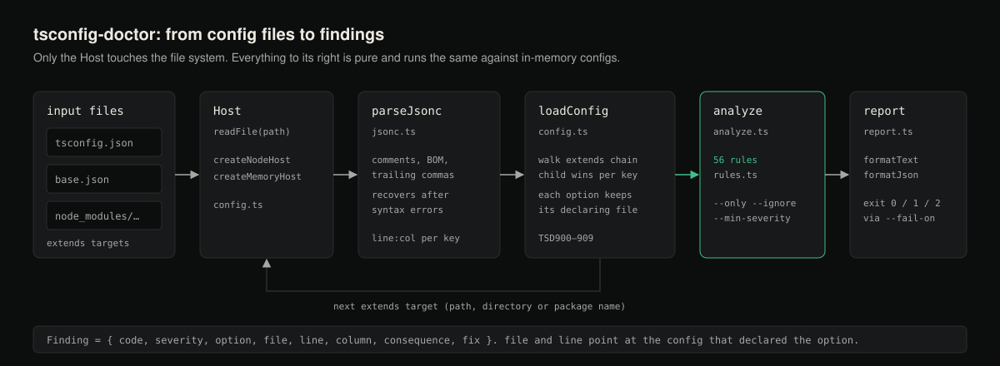

# tsconfig-doctor

Diagnose the `tsconfig.json` settings that silently change what your code does,
and explain the consequence of each rather than the setting.



Status: version 0.1.0, not published to npm. Requires Node.js 20 or newer; CI
runs the tests on Node 20, 22 and 24 on Ubuntu, Windows and macOS.

```bash
git clone https://github.com/hellpuffyt/tsconfig-doctor.git
cd tsconfig-doctor
npm install
npm run build
node dist/bin.js /path/to/your/project      # or: npm link, then `tsconfig-doctor`
```

This package is **not published to npm**. The `tsconfig-doctor` name on the
npm registry belongs to an unrelated project by a different author, so
`npm install tsconfig-doctor` / `npx tsconfig-doctor` install *that* tool, not
this one. The `tsconfig-doctor` examples below assume you have linked this
repository's build with `npm link` (or substitute `node dist/bin.js`).

```
$ tsconfig-doctor examples --only TSD029
examples/tsconfig.json

warning  TSD029  paths
  path aliases survive into the emitted JavaScript unchanged, and fail at
  runtime
  at examples/tsconfig.json:22:5
      This is the most common way a build that type-checks cleanly throws
      `ERR_MODULE_NOT_FOUND` on start-up: tsc resolves `@app/db` for
      type-checking and then emits `require("@app/db")` verbatim. Nothing at
      runtime knows what that means unless a loader, bundler or `paths`-aware
      runtime is configured with the same map.
      fix: Prefer package.json `imports` (`#app/db`), which Node resolves
      natively and TypeScript understands. If you keep `paths`, make the runtime
      resolution part of the build and test the built output, not just the
      sources.

1 warning
```

## Why this exists

A tsconfig is a list of switches, and the documentation for each one describes
the switch. What you actually need to know is what changes *in your program*
when it is off, and that is a different sentence.

`allowSyntheticDefaultImports: true` without `esModuleInterop` is the example
that made this tool. Every reference says the first flag "allows default imports
from modules with no default export". True, and useless. The consequence is that
it changes the **checker** and not the **emitter**, so `import fs from "fs"`
compiles with no complaint and is `undefined` at runtime, and the crash arrives
in a file that does not mention `fs`. That is a finding. "allowSyntheticDefaultImports
is on" is not.

So every rule here answers three questions, and a rule that cannot answer all
three is not in the tool:

1. What does the compiler actually do differently?
2. What breaks, or quietly changes meaning, as a result?
3. What should be typed instead, or why the setting is defensible anyway?

The last one matters. `skipLibCheck: true` is reported, and the fix says it is a
reasonable trade for an application and explains what to do instead if you
publish a library. A tool that only ever says "turn it on" gets muted.

## What it reports

Fifty-six rules, plus ten codes for configs that do not load. Severity is not a
measure of how annoyed the author is: `error` means `tsc` rejects the option,
two options contradict each other, or the setting turns code that type-checks
into code that fails at runtime or on another platform (`TSD001` strict off,
`TSD021`, `TSD062`, `TSD085`); `warning` means the build succeeds and behaves
differently from the obvious reading; `info` means a defensible choice with a
consequence worth knowing.

Every rule that says "tsc rejects this (TS*nnnn*)" is checked against the real
compiler installed in this repository by `test/tsc-claims.test.ts`; the
version-history claims for `TSD042`/`TSD082` were checked against TypeScript
5.4.5, 5.5.4, 5.6.3, 5.7.3, 5.8.3 and 5.9.3.

### Type safety

| Code | Option | What silently changes |
| --- | --- | --- |
| `TSD001` | `strict` | Eight separate checks default to off, and the project still reports zero errors |
| `TSD002` | `strictNullChecks` | `null` and `undefined` join every type; a `string` may be `undefined` at runtime |
| `TSD003` | `noImplicitAny` | One untyped callback parameter switches off checking for a whole call graph |
| `TSD004` | `strictFunctionTypes` | Parameters are checked bivariantly, so a `Dog` handler is accepted where `Animal` is required |
| `TSD005` | `strictPropertyInitialization` | A field declared `name: string` can read `undefined` forever |
| `TSD006` | `useUnknownInCatchVariables` | `catch (e)` is `any`, so `e.message` throws a second error from inside the handler |
| `TSD007` | `strictBindCallApply` | `fn.call(this, 1, 2, 3)` is accepted whatever `fn` takes |
| `TSD008` | `noImplicitThis` | `this` is `any` in exactly the functions whose receiver depends on the call site |
| `TSD009` | `alwaysStrict` | Non-module files run in sloppy mode: assigning an undeclared name creates a global |
| `TSD010` | `noUncheckedIndexedAccess` | `items[0]` is typed `T`, not `T \| undefined`, and this check is not part of `strict` |
| `TSD011` | `exactOptionalPropertyTypes` | `{ name: undefined }` satisfies `{ name?: string }`, which a `PATCH` layer reads as a deletion |
| `TSD012` | `noImplicitOverride` | Renaming a base method leaves the subclass method behind as dead code |
| `TSD013` | `noFallthroughCasesInSwitch` | A forgotten `break` produces a wrong answer rather than a crash |
| `TSD014` | `noImplicitReturns` | One branch of an `if` forgets to return and the function yields `undefined` |
| `TSD015` | `noPropertyAccessFromIndexSignature` | `config.databsaeUrl` type-checks against `process.env` |
| `TSD016` | `strictPropertyInitialization` | Rejected outright (TS5052) without `strictNullChecks` |
| `TSD017` | `skipLibCheck` | Errors in **your own** emitted `.d.ts` files are skipped too |
| `TSD018` | `allowJs` | JavaScript is compiled and its inferred exports trusted, but never checked |
| `TSD019` | `allowUnreachableCode`, `allowUnusedLabels` | Dead code and object literals mis-parsed as labels lose their diagnostic |

### Modules and interop

| Code | Option | What silently changes |
| --- | --- | --- |
| `TSD020` | `esModuleInterop` | `import * as express` is callable here and nowhere else; the code must be rewritten to move to ESM |
| `TSD021` | `allowSyntheticDefaultImports` | Default imports type-check and are `undefined` at runtime |
| `TSD022` | `moduleResolution` | `node`/`node10`/`classic` ignore the `exports` map, so you get an old build's types for the ESM code you run |
| `TSD023` | `module` | Unset, it is derived from `target`, so raising the target rewrites every file from `require` to `import` |
| `TSD024` | `verbatimModuleSyntax` | Type-only imports are elided, dropping side effects and diverging from esbuild's output |
| `TSD025` | `isolatedModules` | Re-exported types and `const enum` pass `tsc` and break every transpile-only build |
| `TSD026` | `moduleDetection` | Deleting the last `export` from a file turns its declarations into globals |
| `TSD027` | `allowImportingTsExtensions` | Rejected (TS5096) in a project that emits |
| `TSD028` | `resolveJsonModule` | Rejected (TS5070) under classic resolution |
| `TSD029` | `paths` | Aliases are never rewritten on emit; `ERR_MODULE_NOT_FOUND` on start-up |

### Target and emit

| Code | Option | What silently changes |
| --- | --- | --- |
| `TSD040` | `target` | Unset means **ES5**: `Promise` and `Object.entries` are undeclared and every class is rewritten |
| `TSD041` | `target` | Below ES2020, syntax is rewritten; the report names only the rewrites your target performs |
| `TSD042` | `target` | `es3` is rejected unless `ignoreDeprecations` (TS5107) up to 5.5, and removed (TS5108) from 5.6 |
| `TSD043` | `useDefineForClassFields` | Class field semantics are decided by `target` alone, and flip at ES2022 |
| `TSD044` | `outDir` | Compiled `.js` lands beside every source file |
| `TSD045` | `rootDir` | Adding one file outside `src` moves `dist/index.js` to `dist/src/index.js` |
| `TSD046` | `declarationMap` | "Go to definition" lands in generated `.d.ts` and edits are lost on the next build |
| `TSD047` | `sourceMap` | Production stack traces name lines that do not exist in your source |
| `TSD048` | `incremental` | `.tsbuildinfo` appears somewhere you did not choose |
| `TSD049` | `noEmitOnError` | JavaScript is written even when the type check fails |
| `TSD050` | `lib` | `lib` **replaces** the target defaults instead of adding to them |
| `TSD051` | `jsx` | `"react"` is the classic runtime: every file needs React in scope or throws |
| `TSD052` | `experimentalDecorators` | The 2015 proposal, not the standard decorators TypeScript 5 implements |
| `TSD053` | `emitDecoratorMetadata` | Rejected (TS5052) without `experimentalDecorators`: there is no metadata for standard decorators |
| `TSD054` | `downlevelIteration` | Below ES2015, spreading a `Map` or a generator iterates zero times, silently |

### Program inputs

| Code | Option | What silently changes |
| --- | --- | --- |
| `TSD060` | `include`, `files` | The program is `**/*`, including whatever appears in the tree later |
| `TSD061` | `types` | Only the packages you list contribute globals; `process` and `Buffer` can vanish |
| `TSD062` | `forceConsistentCasingInFileNames` | `false` builds on macOS and Windows and fails on Linux |
| `TSD063` | `exclude` | `exclude` cannot filter `files`, only `include` |
| `TSD064` | `exclude` | Writing an explicit `exclude` **removes the automatic exclusion of `outDir`** |
| `TSD065` | `typeRoots` | `@types` discovery stops walking up, so hoisted types disappear in a monorepo |

### Structure and deprecations

| Code | Option | What silently changes |
| --- | --- | --- |
| `TSD080` | `composite` | `tsc -p` ignores `references` entirely and checks the sources under *this* project's options |
| `TSD081` | `declaration` | `composite` with `"declaration": false` is rejected (TS6304) |
| `TSD082` | nine options | Deprecated in 5.0 (TS5101 unless `ignoreDeprecations`), removed in 5.6 (TS5102, not silenceable), so the build breaks on a compiler upgrade |
| `TSD083` | any | The option is not a compiler option at all and does nothing |
| `TSD084` | `outDir`, `rootDir`, `baseUrl`, … | An inherited relative path still resolves against the base config's directory |
| `TSD085` | `strict` | One line in a leaf config undoes the whole strict family the base advertises |

### Configs that do not load

| Code | Meaning |
| --- | --- |
| `TSD900` | The config file does not exist |
| `TSD901` | A syntax problem; the parser recovers and reports what it could still read |
| `TSD902` | The root is not an object, so every setting is ignored |
| `TSD903` | `compilerOptions` is not an object, so every option in it is ignored |
| `TSD904` | An `extends` target cannot be found |
| `TSD905` | The `extends` chain is circular |
| `TSD906` | `extends` is not a string or array of strings |
| `TSD907` | A referenced project does not exist |
| `TSD908` | A referenced project does not set `composite: true` |
| `TSD909` | `references` is malformed, so an entry registers no build edge |

## `extends` chains are resolved properly

Most of the interesting mistakes are only visible after inheritance, so the
loader implements TypeScript's merge rules rather than approximating them:

- `compilerOptions` merge key by key, child wins, and values are **replaced,
  not merged**, so an inherited `paths` or `lib` array is discarded whole the
  moment the child mentions it.
- `files`, `include` and `exclude` are inherited, and likewise replaced.
- `references` are **not** inherited.
- An array `extends` applies left to right, so the last entry wins.
- Relative paths keep the meaning they had in the file that wrote them.

Every option therefore remembers which file declared it, which is why the
report points at the base config rather than the one you named:

```
$ tsconfig-doctor packages/api --only TSD084      # run in test/fixtures/inherited; excerpt
packages/api/tsconfig.json
extends: base/tsconfig.base.json -> packages/api/tsconfig.json

warning  TSD084  outDir
  `outDir` is inherited, so it points relative to the base config, not to this
  one
  at base/tsconfig.base.json:9:5
```

`extends` resolves relative paths, directories, `.json`-less specifiers, and
package names looked up through `node_modules` walking upwards, so
`"extends": "@tsconfig/node20/tsconfig.json"` works, and so does a cycle, which
is reported once instead of hanging.

## JSON with comments, and JSON that is broken

`tsconfig.json` is not JSON, so the parser is not a `JSON.parse` wrapper. It is
written from scratch (this package has **zero runtime dependencies**) and it
does two things a strict parser cannot:

**It reads real files.** Line and block comments, trailing commas, a UTF-8 BOM.
It also accepts single-quoted strings and unquoted keys, and reports them,
because `tsc` will not.

**It recovers.** A missing comma is a diagnostic, not the end of the parse:

```
$ tsconfig-doctor test/fixtures/malformed/missing-comma.json --only TSD901
error    TSD901
  the config does not parse cleanly: expected ',' but found "target"
  at test/fixtures/malformed/missing-comma.json:4:5
```

...and every option after that line is still read and still diagnosed. A file
that is entirely garbage produces diagnostics rather than an exception; the
suite asserts that on a table of malformed inputs.

## Options

```
tsconfig-doctor [path] [options]

  path                     a tsconfig.json, or a directory containing one.
                           Defaults to ./tsconfig.json.

  --json                   emit machine-readable JSON instead of prose
  --min-severity LEVEL     hide findings below LEVEL (error|warning|info)
  --fail-on LEVEL          exit 1 at LEVEL or above (error|warning|info|never)
  --ignore CODES           comma-separated codes to suppress
  --only CODES             comma-separated codes to report exclusively
  --width N                wrap prose at N columns (default 80)
  --list-rules             print every rule code and the option it inspects
  -h, --help               show the usage text
  -V, --version            print the version
```

Exit code `0` means nothing at or above `--fail-on` (default `error`), `1` means
there was, and `2` means the arguments could not be understood. Adopting the
tool on an existing project usually starts at `--fail-on error`, then
`--fail-on warning` once those are cleared.

`--json` output is stable and sorted, so it diffs between commits. Paths are
absolute; this is `tsconfig-doctor examples --json --only TSD029` with the
checkout directory shortened to `/repo`:

```json
{
  "file": "/repo/examples/tsconfig.json",
  "chain": ["/repo/examples/tsconfig.json"],
  "summary": { "error": 0, "warning": 1, "info": 0, "total": 1 },
  "findings": [
    {
      "code": "TSD029",
      "severity": "warning",
      "title": "path aliases survive into the emitted JavaScript unchanged, and fail at runtime",
      "option": "paths",
      "file": "/repo/examples/tsconfig.json",
      "line": 22,
      "column": 5,
      "consequence": "...",
      "fix": "..."
    }
  ]
}
```

## As a library

The analysis core is pure. It takes a resolved config and returns findings; it
never reads a file, which is why the whole rule set can be exercised against
configs held in memory. Because the package is not on npm, the import below
resolves only after `npm link` (or `npm link tsconfig-doctor` inside your
project), or with this repository installed from a local path.

```ts
import { analyze, createMemoryHost, loadConfig } from 'tsconfig-doctor';

const host = createMemoryHost({
  '/p/base.json': '{ "compilerOptions": { "strict": true } }',
  '/p/tsconfig.json': '{ "extends": "./base.json", "include": ["src"] }',
});

for (const finding of analyze(loadConfig('/p/tsconfig.json', host))) {
  console.log(`${finding.severity} ${finding.code}: ${finding.title}`);
  console.log(`  declared in ${finding.file}`);
}
```

The base config sets only `strict`, so the leaf still gets findings such as:

```
warning TSD010: indexing an array or record is typed as always succeeding
  declared in /p/tsconfig.json
warning TSD040: the target defaults to ES5, so modern syntax is rewritten and modern globals are missing
  declared in /p/tsconfig.json
```

`Host` is a single method, `readFile(path): string | undefined`, so the loader
can be pointed at a virtual file system, a git object store, or `node:fs` via
`createNodeHost`. The JSONC parser (`parseJsonc`, with full location
information) and the reporters (`formatText`, `formatJson`) are exported
separately, because each is useful on its own.

## This repository is its own test case

`tsconfig.json` and `tsconfig.build.json` here are asserted to produce **no
findings at all**: by a unit test (`test/package.test.ts`), and again by a CI
job that builds the package and runs `node dist/bin.js` against them. The same
job asserts that `examples/` exits 1 under `--fail-on warning`.

`tsconfig.test.json` is not clean, on purpose. It sets `skipLibCheck`, and
`TSD017` reports it. The reason is in the file: with
`exactOptionalPropertyTypes` on, `vite`'s published declarations do not
type-check against `rollup`'s, because `Plugin.load` takes an optional property
that one side declares `boolean` and the other `boolean | undefined`. That is a
real error in a dependency's shipped `.d.ts`, found by the very check that
`skipLibCheck` turns off. That is the finding's own argument, demonstrated.
Splitting it into its own config keeps the suppression scoped to the files that
need it rather than to the whole project.

## Development

```bash
npm install
npm run typecheck    # tsc --noEmit, strict, on src and on the tests
npm run lint         # eslint + @typescript-eslint
npm test             # vitest
npm run coverage     # vitest, with a 95% floor on every metric
npm run build        # tsc -p tsconfig.build.json
```

See [CONTRIBUTING.md](CONTRIBUTING.md) for the design constraints a change has
to respect, and for how to add a rule.

## Limitations

- It reads configuration only. It does not run `tsc` or look at your source
  files, so a finding says what a setting does, not whether your code hits it.
- The rule text is written against TypeScript 5.x. Version-specific claims name
  the versions they were checked on.
- Not published to npm (see above), so there is no `npx` route.

## Security

The tool reads config files and never executes anything from them. Report
vulnerabilities privately as described in [SECURITY.md](SECURITY.md).

## License

MIT. See [LICENSE](LICENSE).
